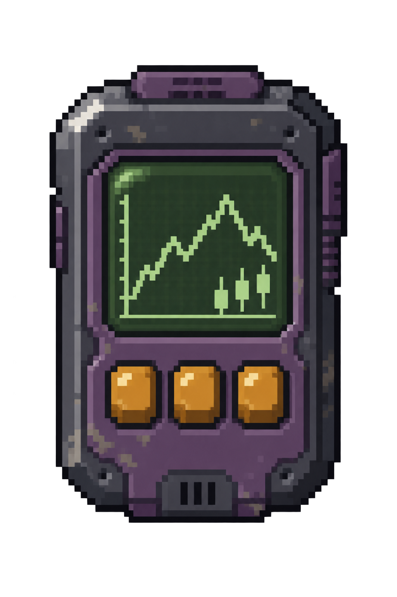

# Probably Stolen 股市 Mod

基于 MelonLoader 的投资玩法 Mod：10 家虚构公司、商品交叉关联、顾客成交驱动行情、原版事件跳价、现货持仓与付费真假内幕。

进入存档后自动赠送“股市面板”，双击打开。现货买卖默认开放，资金与投资状态随原版存档保存。背包满时延后赠送，旧版道具编号失效时可按 `Ctrl+F8` 显式恢复，已发放后不会因空查询重复创建。

## 当前状态

开发目标为 Probably Stolen Demo 0.46D、Unity 2021.3.45f2、MelonLoader 0.7.3、Windows .NET 6 IL2CPP 环境。使用 CrossOver 安装时，构建路径填写容器在 macOS 上的实际磁盘路径。

已完成源码、独立逻辑测试、构建与部署配置。游戏中的回调顺序、背包入口、保存恢复与画面显示需要实际游玩验收；测试和编译通过不能代替游戏内验证。详见 [开发与安装说明](MelonModTemplate/README.md) 和 [适配证据与验收步骤](MelonModTemplate/Game/ADAPTER-NOTES.md)。

第 41～42 日 K 线、批发成交漏记及交易门控的检查结果见 [行情诊断](docs/PRICE-DIAGNOSIS.md)。

## 玩法

- 商品成交按分类权重分配到多家公司，多分类取平均；玩家卖出利好，买入利空，当日买卖先抵消，次日统一结算前一天的成交信号。成交和遣散顾客都不即时变价。
- 每日小幅波动与估值回归叠加昨日成交量影响，默认非事件变动合计不超过 ±3%，其中成交影响上限为 ±2%。事件期内随机一天大幅跳价，此前可能小幅预热，之后小幅延续，结束后逐步消退并随机保留 20%～50% 的实际影响；同一事件可让不同公司出现相反走势。
- 未显式配置的事件根据原版商品价格修正反向推导股价：商品涨价对应相关公司利空，降价对应利好，再按商品关联权重分配并限幅。例如供水危机提高水和净水物资售价，将压低相关股票；自定义事件影响表仍优先。
- 使用原版资金买卖整数股，显示持仓、成本、盈亏、手续费和流水。
- 原生界面包含公司列表、当日分时走势、7/14/30 日 K 线和委托；保存每日结算、当日事件变价及每日开高低收，旧档未知部分明确标注。
- 图表支持鼠标悬停：分时查看价格与变价原因，日 K 线查看当天开高低收。
- 持有股市面板后，在原版电话簿点击“闻舟”快速拨号，或手动拨打 **731206**；弹窗确认后预约次日营业时到访。闻舟初次见面会自我介绍，随后在原版情报购买界面交易。付款前只透露来源和商品类别，购后提供行业型或指定公司型预测、原生纸条及次日起三日的日历提醒。
- 真假内幕按事件实际影响方向验证，行业身份与历史记录影响来源信誉；取消或无法核实的事件不损害信誉。股市面板的“内幕档案”保留已购内容。
- 电话预约需要有可售线索，取消或挂断确认窗口不会创建新预约。报价、首次见面状态与来访计划随存档保存，重复拨号不重抽；“内幕档案”可查看号码与预约状态。
- 独立透明像素风终端图标，显式刷新背包与拖拽图像；双击使用游戏原生窗口、按钮、输入框和字体素材。保存时仍使用原版便笺资源标识。

## 开发

1. 安装 MelonLoader 并运行游戏一次，生成对应版本的 `MelonLoader/Il2CppAssemblies`。
2. 复制 `MelonModTemplate/Game.local.props.example` 为 `Game.local.props`，填写 `GameDirectory`。
3. 执行 `dotnet build MelonModTemplate/MelonModTemplate.csproj -c Release`。构建成功后自动部署 DLL 和资源；只编译使用 `-p:DeployOnBuild=false`。

模组目标框架为 .NET 6；独立测试使用 .NET 10 SDK，命令为 `dotnet run --project Tests/StockMarket.Tests`。测试不加载游戏，也不需要游戏 DLL。

运行配置首次生成在 `<游戏>/UserData/MelonModTemplate/market-config.json`。修改后重启游戏生效；非法配置会停止股市初始化并保留原文件。已有配置不会被构建覆盖。

0.10.0 为自动事件规则增加来源和方向版本。能确认来源的旧事件若尚未大跳，只更新未来影响方向，保留已发生的预热、随机日期及实际价格；已执行大跳的事件继续原有生命周期。方向调整涉及的旧待核实内幕标为“未能验证”，不扣来源信誉。仍与旧版出厂配置完全一致的动员事件规则会在加载时升级，用户修改过的显式规则保留。

## 来源

开发流程参考 [dragonpan2/probably-stolen-modding](https://github.com/dragonpan2/probably-stolen-modding) 的 LearnerMod。当前游戏的原生 ModLoader 处于受限状态，因此实现使用 MelonLoader 与 Harmony；不依赖较新原生 ModHelper API。加载器、游戏及生成代理程序集不包含在仓库中。
